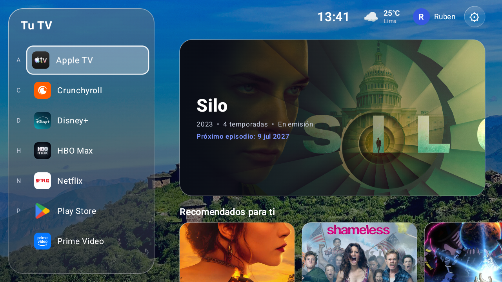

# TV Launcher

Launcher personalizado para Android TV hecho con Jetpack Compose.



## Qué incluye

- Lista lateral de apps instaladas.
- Destacado con título, metadatos y próximo episodio.
- Fila de "Recomendados para ti".
- Reloj, clima y perfil en la parte superior.

## Requisitos

- Android Studio o JDK compatible con el proyecto.
- Android SDK con `platform-tools` (para `adb`).
- Un Android TV con depuración ADB activada.

## Compilar e instalar

```sh
./gradlew assembleDebug
adb connect <ip-de-tu-tv>
adb install -r app/build/outputs/apk/debug/app-debug.apk
```

Tras reinstalar, reinicia el launcher para que cargue el código nuevo:

```sh
adb shell am force-stop com.rubendt.tvlauncher
```
